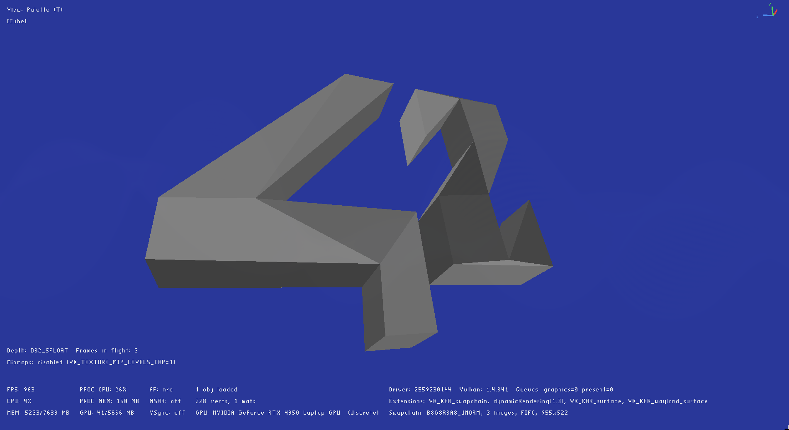
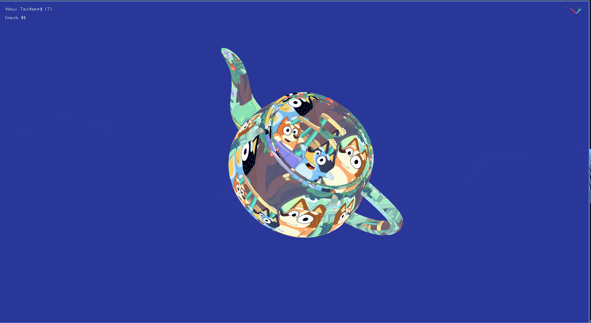
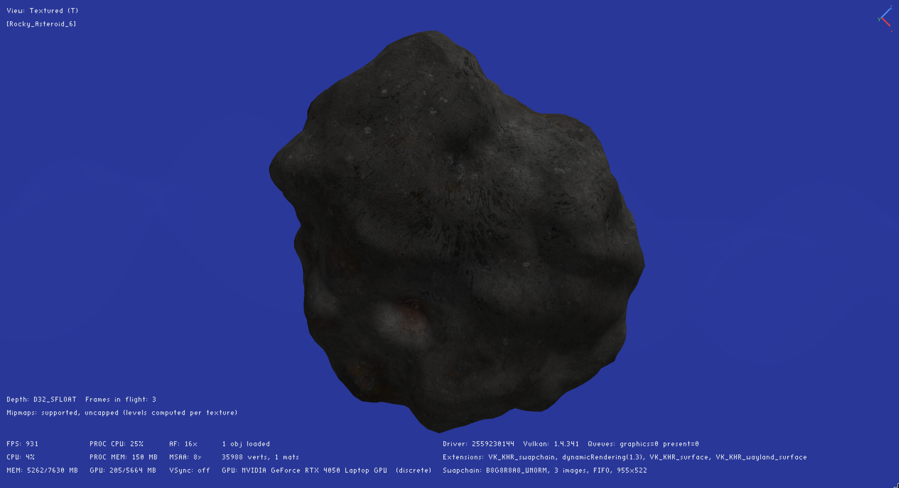
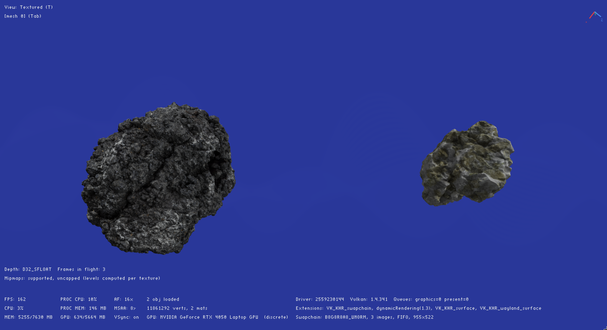
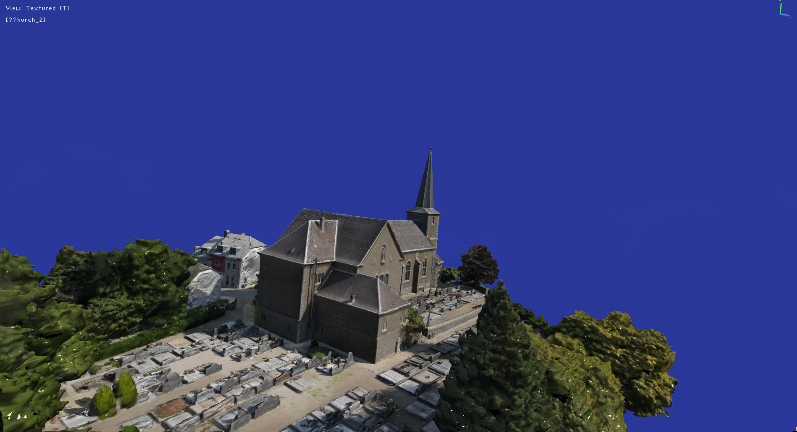
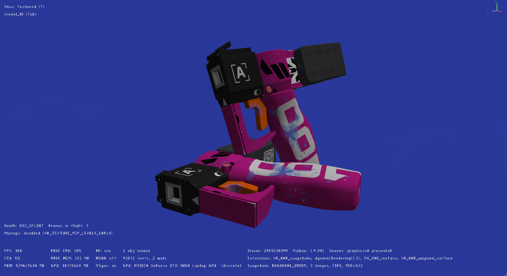
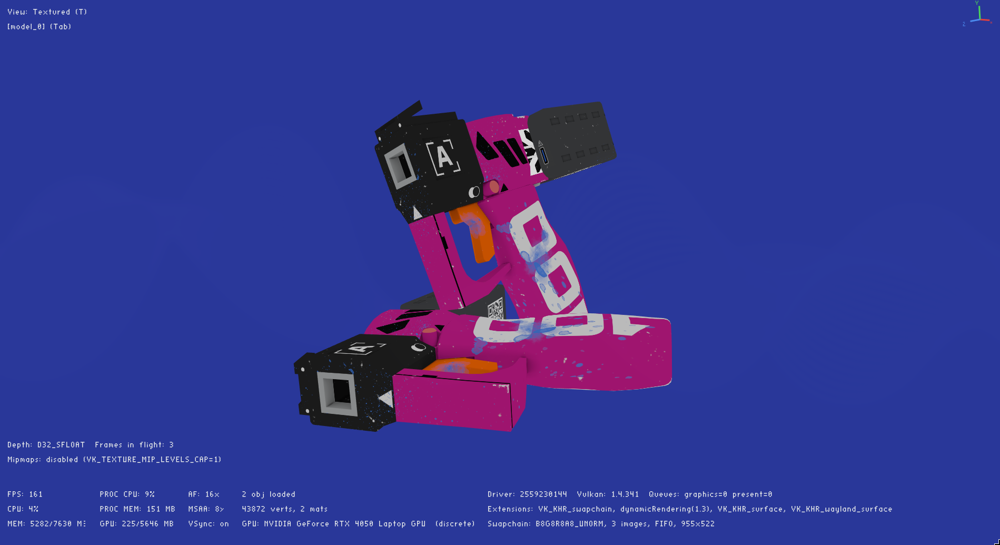

<div align="center">

*This project has been created as part of the 42 curriculum by me.*

# scop

Introduction to GPU rendering using Vulkan



</div>

## Gallery

<div align="center">

<table>
<tr>
<td width="33%"></td>
<td width="33%"></td>
<td width="33%"></td>
</tr>
<tr>
<td align="center"><sub>Utah teapot, the classic</sub></td>
<td align="center"><sub>Textured rock</sub></td>
<td align="center"><sub>NASA rock scan</sub></td>
</tr>
</table>



<sub>Satellite scanned church model</sub>

<table>
<tr>
<td width="50%"></td>
<td width="50%"></td>
</tr>
<tr>
<td align="center"><sub>Lighting on, MSAA/AA off</sub></td>
<td align="center"><sub>Lighting off, MSAA + antialiasing on</sub></td>
</tr>
</table>

</div>

## Description

`scop` is a from scratch 3D model viewer built as one of 42's graphics projects.
It parses a `.obj` file, uploads the resulting mesh(es) to the GPU, and renders them
through a hand rolled Vulkan renderer (windowing/input via GLFW). The goal of the project
is to understand the full graphics pipeline with no engine in between: manual `.obj`
parsing, manual Vulkan device/swapchain/pipeline setup, manual synchronization, and a
small runtime UI to inspect what's loaded.

Once running, the viewer lets you orbit/move the camera, select and transform loaded
objects, toggle textures/grid/wireframe info, and inspect basic render stats.

<div align="center">

| | |
|:---:|:---:|
| **Language** | C++20 (app) + C (Vulkan backend) |
| **Graphics API** | Vulkan 1.3 (Dynamic Rendering) |
| **Windowing** | GLFW |
| **Input format** | Wavefront `.obj` (+ `.mtl` & `.png`) |

</div>

## Instructions

### Requirements

| # | Requirement |
|:---:|:---|
| 1 | A GPU + driver supporting **Vulkan 1.3** (the renderer uses Dynamic Rendering, `VK_KHR_dynamic_rendering`, instead of the old render pass/framebuffer model) |
| 2 | A windowing environment (Wayland or X11) able to open/manage a window. That is what **GLFW** talks to |
| 3 | `glslangValidator`, to compile the GLSL shaders to SPIR-V at build time (already compiled shaders should also be shipped in the repo) |
| 4 | A C++20 compiler (`c++`) and a C compiler (`cc`) |
| 5 | `make` and `pkg-config`. `cmake` needed only if you need to vendor `glfw3`/`vulkan` |

`pkg-config` is used to find `glfw3` and `vulkan` on the system. If either isn't found,
the `Makefile` clones and builds it locally under `.deps/` instead (a real GPU driver /
ICD is still required for Vulkan regardless). The makefile also vendorizes `libftpp` (my C++17 utility library) under `.deps/`.

### Compilation

```bash
make
make lite
make help
```

### Execution

```bash
./scop [path...]
```

Each argument is either a `.obj` file or a directory (all `.obj` files inside it are
loaded).

### Controls

<div align="center">

| Input | Action |
|:---:|:---|
| `W` `A` `S` `D` | Move camera |
| `Space` / `Left Ctrl` | Move camera up / down |
| `Shift` (held) | Select all objects |
| `Tab` | Select next object |
| Arrow keys | Move selected object |
| `Right Ctrl` / `Right Shift` | Move selected object down / up |
| Left mouse drag | Rotate selected object |
| Numpad `7`/`9`, `4`/`6`, `1`/`3` | Rotate selected object (pitch, yaw, roll) |
| `R` | Reset selected object's transform |
| `H` | Hide/show other objects |
| `T` | Toggle texture |
| `F3` | Toggle debug/info overlay |
| `F4` | Toggle grid |
| `F5` | Toggle V-Sync |
| `Esc` | Quit |

</div>

## .obj parsing

The parser (`utils/obj/`) is a straightforward line based reader. It triangulates on the
fly while building the final vertex buffer.

<div align="center">

| Symbol | Meaning | Status |
|:---:|:---|:---:|
| `v` | vertex position | used |
| `vn` | vertex normal | used (else computed and smoothed per `s` group) |
| `vt` | texture coordinate | used (else triplanar/box UV fallback) |
| `f` | face (triangle / n-gon) | used, fan triangulated, supports `v`, `v/vt`, `v/vt/vn`, `v//vn`, negative indices |
| `o` | object name | used, starts a new sub-mesh |
| `s` | smoothing group | used, drives normal accumulation |
| `usemtl` / `mtllib` | material / texture assignment | used, via `.mtl` loader |
| `l` | polyline | parsed only, never uploaded or drawn 🚫 |
| `p` | point list | parsed only, never uploaded or drawn 🚫 |
| `g` | group | not implemented, skipped 🚫 |
| `vp` | parameter space vertex | not implemented, skipped 🚫 |
| any unknown | anything else | skipped, logged at debug level |

</div>

## Known issues

| Issue | Detail |
|:---|:---|
| No frustum/occlusion culling | Every uploaded mesh is drawn every frame regardless of visibility |
| No backface culling | `VK_CULL_MODE_NONE` is set on purpose in the pipeline, both faces are always rasterized |
| `l` / `p` dropped | Parsed but silently dropped at render time instead of being rendered or rejected |
| No load feedback | Large `.obj` files pay a one time CPU parse + upload cost with no progress indicator |
| Push constant size | The per draw call push constant (mvp + model + camPos) is 144 bytes, above Vulkan's guaranteed minimum of 128. Every desktop GPU reports >=256, so this hasn't been an issue in practice, but it isn't queried/validated against `maxPushConstantsRange` and would need a descriptor bound UBO fallback on unusual/mobile hardware |
| Debug overlay present mode label | The FIFO/MAILBOX label shown in the debug panel (`F3`) isn't refreshed when V-Sync is toggled (`F5`), it can show a stale value |
| Swapchain recreation freeze | On some machines (Wayland in particular), resizing/moving the window with V-Sync off can freeze rendering until another input/action is given. Root cause wasn't pinned down (resize detection ordering, or window manager behavior); since it doesn't break the project's actual functionality and V-Sync isn't mandatory, it was left as is |
| Global Vulkan state | The Vulkan backend (`engine/vk/`) is built around global state (`context.h`) rather than passed-around handles/objects. This was a scope decision made early and kept deliberately, by project convention this is where it belongs, not a place C++ classes would help |
| No file/resource guardrails | The loader doesn't cap the size, count, or validate the type of files a user points it at; a texture downscaling safeguard was implemented then removed, since nobody but the project's grader will ever run this on adversarial input, the user is trusted with what they load |

### Vendored code

Two vendored single header libraries are used, both under `includes/vendor/`, which
technically could be read as "using a library" (against what 42's project asked):

| File | Used for | Why vendored |
|:---|:---|:---|
| `stb_image.h` | decoding `.png` textures | Writing a PNG decoder from scratch was out of scope for a graphics pipeline project. A hand rolled `.ppm` reader was the first choice (trivial format, easy to parse), but `.ppm` is impractical: virtually nobody ships models with `.ppm` textures, and supporting it wouldn't have changed anything about the project itself |
| `stb_easy_font.h` | rendering the debug overlay's text (`F3`) | The overlay/GUI is a bonus feature, not a mandatory part of the project; the font renderer only affects that bonus panel, never the mandatory render path |

## Resources

### Vulkan / rendering

| Resource | Note |
|:---|:---|
| [Vulkan Specification](https://docs.vulkan.org/spec/latest/) | reference for everything below |
| [vkguide.dev](https://vkguide.dev/) | main tutorial for renderer structure |
| [vkguide: project libs](https://vkguide.dev/docs/introduction/project_libs/) | project/lib setup chapter |
| [The New Vulkan Coordinate System](https://matthewwellings.com/blog/the-new-vulkan-coordinate-system/) | Vulkan's Y flip / clip space |
| [Setting up a proper Vulkan projection matrix](https://johannesugb.github.io/gpu-programming/setting-up-a-proper-vulkan-projection-matrix/) | projection matrix derivation |

### Math

| Resource | Note |
|:---|:---|
| [gamemath.com](https://gamemath.com/book/) | vectors/matrices/quaternions reference |
| [Linear algebra further reading, datafield.dev](https://datafield.dev/linear-algebra/part-02/chapter-12/further-reading.html) | linear algebra deep dive |
| [CS418, UIUC](https://courses.grainger.illinois.edu/cs418/fa2026/) | course material used as a math/graphics refresher |

### Lighting

| Resource | Note |
|:---|:---|
| [LearnOpenGL: Colors](https://learnopengl.com/Lighting/Colors) | lighting basics |
| [LearnOpenGL: Basic Lighting](https://learnopengl.com/Lighting/Basic-Lighting) | Phong shading |
| [Blinn–Phong reflection model, Wikipedia](https://en.wikipedia.org/wiki/Blinn%E2%80%93Phong_reflection_model) | shading model reference |
| [LearnOpenGL](https://learnopengl.com/) | general reference, API differs but shading theory carried over |

### .obj format

| Resource | Note |
|:---|:---|
| [What is an .obj file? Open3D blog](https://open3d.app/blog/what-is-obj-file/) | format overview |
| [Wavefront .obj file, Wikipedia](https://en.wikipedia.org/wiki/Wavefront_.obj_file) | format reference |
| [CS418: obj format](https://cs418.cs.illinois.edu/website/text/obj.html) | directive by directive breakdown |

### Videos

| Resource |
|:---|
| [youtu.be/C8YtdC8mxTU](https://youtu.be/C8YtdC8mxTU) |
| [youtu.be/h9Z4oGN89MU](https://youtu.be/h9Z4oGN89MU) |

### AI usage

AI was used as a support tool throughout the project. Concretely, it was used to:

**Debug hard to diagnose bugs.** Notably a synchronization/semaphore bug in the frame
submission logic, and a reversed depth test bug, both fixed with AI help after manual
debugging stalled.

**Generate test resources.** The `.obj` files under `resources/other_tests/` (edge cases,
malformed input, smoothing groups, negative indices, etc.) were AI generated to exercise
the parser against a wide range of cases. It also generated some tests for some specific
functions when needed.

**Teach and explain.** Used interactively (`/teach` and other skills are so strong) to consolidate understanding of Vulkan API
concepts, as well as how to avoid naive mistakes.

**Small refactors.** For example moving a value from a push constant to a descriptor set,
a mechanical change following a pattern already used elsewhere in the codebase.

**Code review.** A full review and test sweep over the codebase for correctness and
cleanup before submission.
